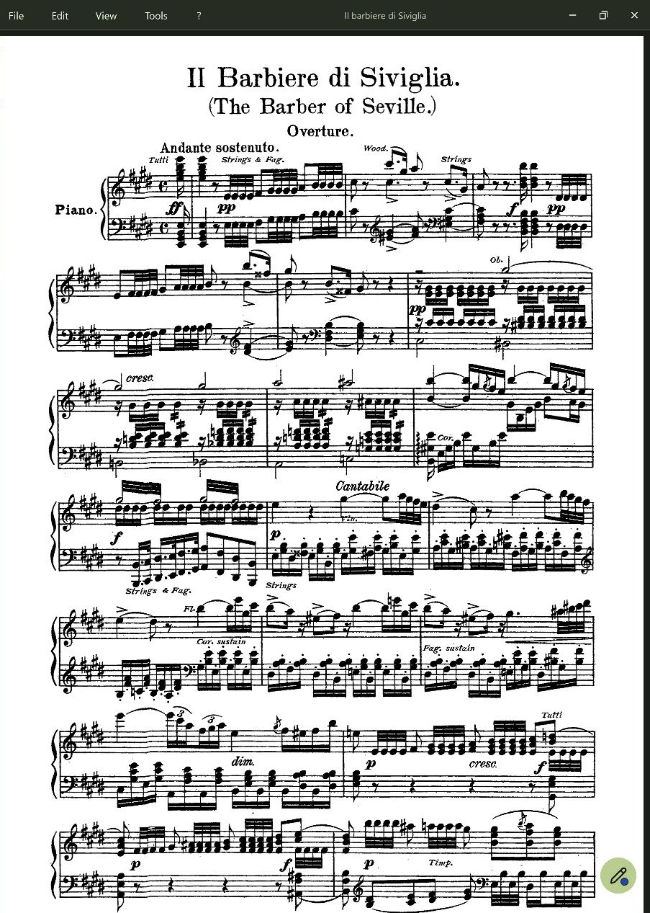
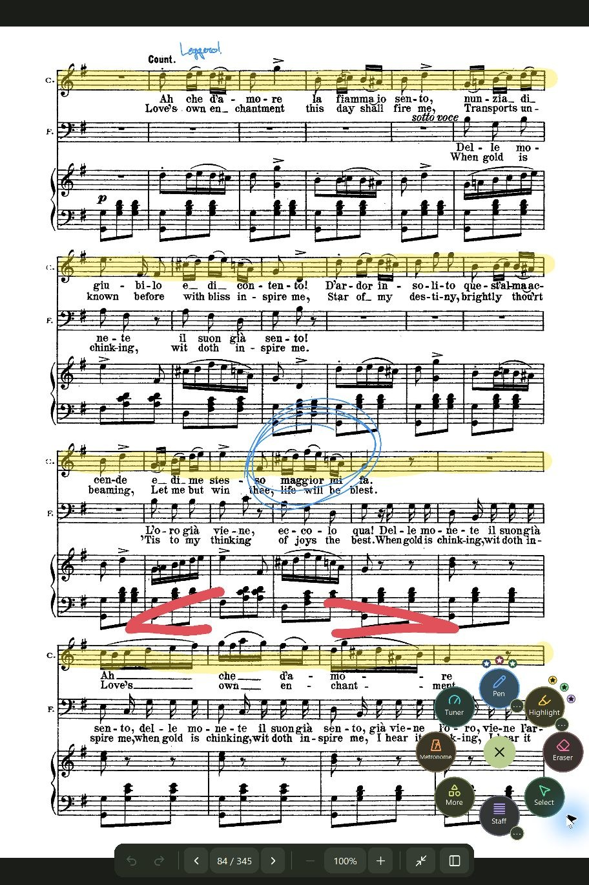
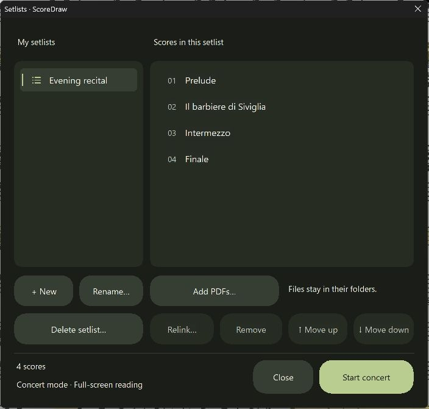
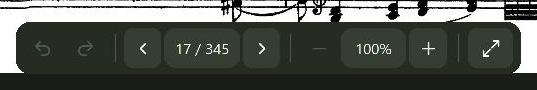
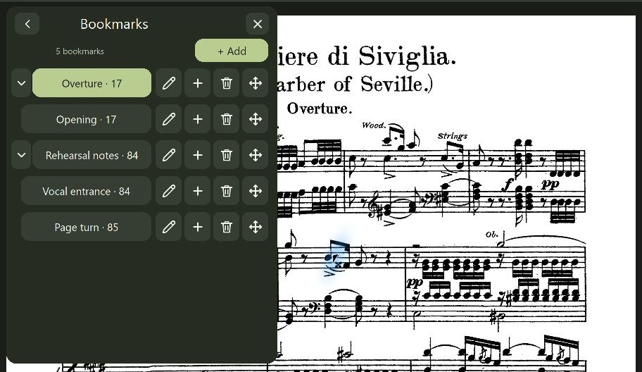
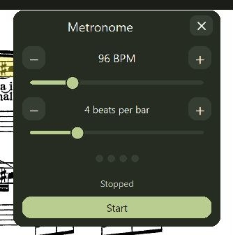
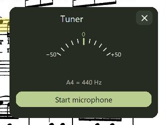

# ScoreDraw

**A Windows PDF score reader for practice and performance.**

I've used a Microsoft Surface to read and annotate my scores for years. General-purpose PDF editors often felt crowded on a tablet, and with large scanned scores I could be left waiting for the file to open or the next page to appear. During a concert, even a short delay between pages matters. In practice, I also wanted something as simple as adding a blank staff to write out a variation. That's why I built ScoreDraw.

ScoreDraw is open source and written in Rust. It renders PDF pages on demand and prepares the pages on either side of the one you're reading. For practice, it brings together pressure-sensitive pen input, a highlighter, an eraser, extra staves, bookmarks, a metronome and a tuner. For concerts, you can arrange your existing PDFs in performance order and keep turning pages from one score into the next. Setlists link to the original files, so your library stays in one place and you work with one set of annotations per file.

## Availability

**[Get ScoreDraw on the Microsoft Store](https://apps.microsoft.com/detail/9N5Q5Q5N916X)**

The interface is available in English and Italian. It follows the Windows display language by default, and you can change it under **Tools → Settings → Language**.

The [contributor guide](CONTRIBUTING.md#build-on-windows) includes instructions for building from source on Windows.

## Quick start

### Open a score

Choose **File → Open PDF**. Swipe sideways with one finger on the touchscreen or two fingers on a trackpad, or use the **←** and **→** keys to turn pages. Spread two fingers on the touchscreen to zoom in and pinch to zoom out. Portrait orientation lets you keep a full page in view on a Surface or other Windows tablet.

### Annotate a score

Tap the round green button to open the radial menu. Choose **Pen**, **Highlight** or **Eraser**. The pen responds to pressure when you use a compatible stylus. Tap **…** next to a tool to adjust its available options, such as color, thickness or opacity. You can keep the menu open while you work. ScoreDraw saves your annotations automatically.

### Prepare a concert

1. Open **File → Setlists** and select **New**.
2. Use **Add PDFs** to link your scores and arrange them with **Move up** and **Move down**.
3. Select **Start concert**. ScoreDraw enters full-screen reading and keeps the display awake.

Turn past the last page of a score to continue with the next one in the setlist. Use the exit full-screen button in the bottom toolbar or press **Esc** to return to the window. If you move a PDF to another folder, select it in the setlist and use **Relink** to update its location.

### Share an annotated score

Choose **File → Make changes permanent** to embed your annotations and bookmarks in the PDF. You can create a copy or update the original. In concert mode, choose the current PDF or the entire setlist. Once embedded, the changes travel with the PDF and are visible in other PDF readers.

## Controls and keyboard shortcuts

### Reading toolbar and page navigation

The bottom toolbar hides to give the score more room. Move the mouse, bring the pen close to the screen or touch the display to reveal it. It contains undo and redo, page navigation, zoom and the full-screen controls. Tap the page number or press **Ctrl+G** to jump to a page. When several scores are open, the page picker also lets you choose another score.

### Zoom and pan

Use **+ / −**, **Ctrl+mouse wheel** or the slider that opens when you tap the zoom percentage. **Ctrl+0** fits the page to the window. When zoomed in, pan by dragging with one finger, scrolling vertically on the trackpad or dragging with the middle mouse button.

### Favorite tools and shapes

- **Favorites.** Save a pen or highlighter style to one of its three slots in the tool options. Tap the corresponding star in the radial menu to recall the saved style.
- **Shapes.** **Staff** inserts a blank staff and **More → Rectangle** adds a rectangle. Use **Select** and tap a shape to move it or resize it with the handles. Use the trash button or **Delete** to remove it.

### Bookmarks

Press **Ctrl+B** or choose **View → Bookmarks** to open the outline. Select a bookmark to jump to its page. Use the row controls to edit or remove it. Drag a bookmark above or below another entry to reorder it, or onto the middle of another entry to nest it.

### Metronome and tuner

Open either tool from the radial menu, or press **Ctrl+M** for the metronome and **Ctrl+T** for the tuner. Drag a panel by its header to reposition it while keeping the score in view.

- **Metronome.** Set the tempo and the number of beats per bar. The beat indicators pulse as it plays.

  

- **Tuner.** Select **Start microphone** to listen for a sustained note. The needle shows how far the pitch is from the nearest note. Audio analysis runs on the device.

  

### Settings

Open **Tools → Settings** to enable page turns by tapping the screen edges, change the interface language or open Windows Settings to choose the default PDF app.

## Local data

ScoreDraw stores setlists, settings, annotations and bookmark edits on your device. The development build uses `%LOCALAPPDATA%\ScoreDraw` by default. Local edits belong to the individual PDF file. Replacing the file with another PDF at the same path starts with a fresh set of local edits.

## Feedback and contributions

Send bug reports, feature suggestions, and proposed code changes by email to [info@emanuelecampilongo.com](mailto:info@emanuelecampilongo.com). To copy the address from the app, open **? → Feedback**. For a bug, include your ScoreDraw version and the steps to reproduce it.

See [Contributing to ScoreDraw](CONTRIBUTING.md) for what to include in your email and how to build and test changes.

## License and credits

Copyright © 2026 Emanuele Campilongo.

ScoreDraw is licensed under the [GNU General Public License, version 3](LICENSE), SPDX identifier `GPL-3.0-only`. If you distribute a modified version, you must make its corresponding source code available to recipients under the same license.

Created and maintained by [Emanuele Campilongo](https://emanuelecampilongo.com).

The [third-party notices](THIRD_PARTY_NOTICES.md) credit the Lucide and Feather icons. PDFium is distributed with its own license notices. In ScoreDraw, see **? → About → Credits and licenses**.

The score shown in the screenshots is Gioachino Rossini's *Il barbiere di Siviglia* (*The Barber of Seville*), published by G. Schirmer in 1900.
