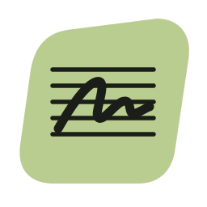
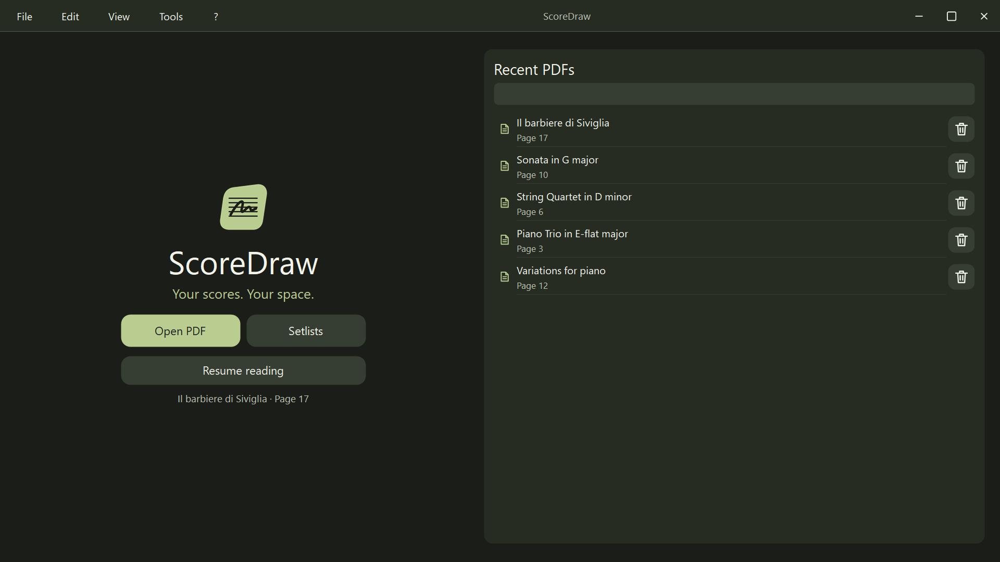
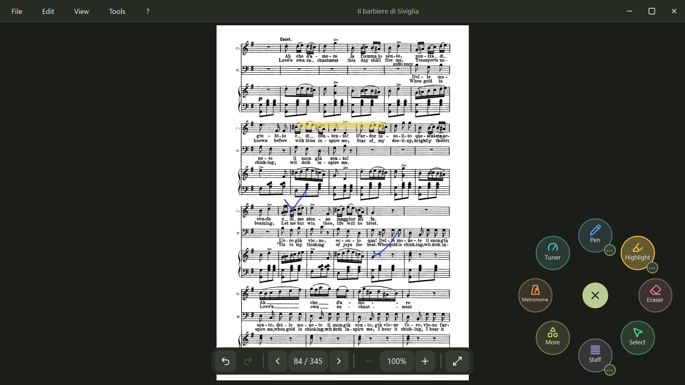
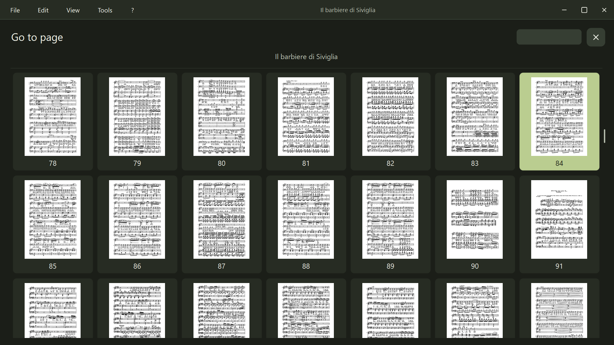
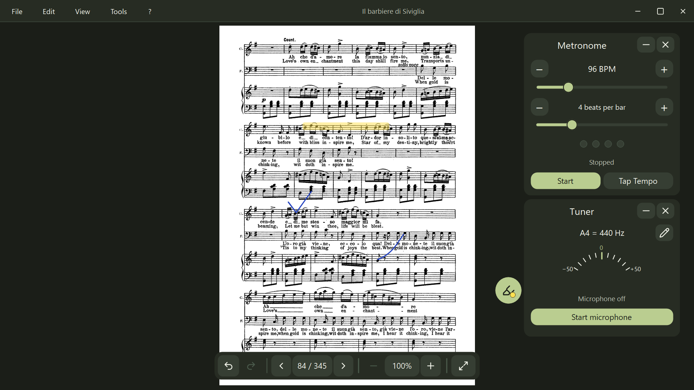

# ScoreDraw

**A Windows PDF score reader for practice and performance.**

I've used a Microsoft Surface to read and annotate my scores for years. General-purpose PDF editors often felt crowded on a tablet, and with large scanned scores I could be left waiting for the file to open or the next page to appear. During a concert, even a short delay between pages matters. In practice, I also wanted something as simple as adding a blank staff to write out a variation. That's why I built ScoreDraw.

ScoreDraw is open source and written in Rust. It renders PDF pages on demand and prepares the pages on either side of the one you're reading. For practice, it brings together pressure-sensitive pen input, a highlighter, an eraser, extra staves, bookmarks, a metronome and a tuner. For concerts, you can arrange your existing PDFs in performance order and keep turning pages from one score into the next. Setlists link to the original files, so your library stays in one place and you work with one set of annotations per file.

## Availability

**[Get ScoreDraw on the Microsoft Store](https://apps.microsoft.com/detail/9N5Q5Q5N916X)**

The interface is available in English and Italian. It follows the Windows display language by default, and you can change it under **Tools → Settings → Language**.

The [contributor guide](CONTRIBUTING.md#build-on-windows) includes instructions for building from source on Windows.

## Quick start

### Open a score

From Home, choose **Open PDF**, **Setlists**, or **Resume reading** to return to the last page you reached. The searchable list keeps up to 50 recent PDFs. Removing an entry leaves the source PDF on disk. PDFs opened from File Explorer go straight to the score.

Swipe sideways on a touchscreen or trackpad, or use **←** and **→** to turn pages. At fit-to-page zoom, a one-finger swipe follows your finger and returns to the current page if you release before the turn threshold. Pinch to zoom on a touchscreen.

### Annotate a score

Tap the round green button to open the radial menu. Choose **Pen**, **Highlight** or **Eraser**. The pen responds to pressure when you use a compatible stylus. Tap **…** next to a tool to adjust its available options, such as color, thickness or opacity. You can keep the menu open while you work. ScoreDraw saves your annotations automatically.

### Prepare a concert

1. Open **File → Setlists** and use **+** to create a setlist.
2. Use **Add PDFs** to link your scores. Drag the handle on each row to change the order. Use the page-range icon to limit a score to specific pages. The same PDF can appear more than once with different ranges.
3. Select **Start concert**. The concert opens in the window and keeps the display awake. Use **F11** to switch to full screen when you want it.

Turn past the last playable page to continue into the next score, or use the toolbar controls to jump directly to the previous or next score. The relink and remove icons are on each score row.

### Share an annotated score

Choose **File → Make changes permanent** to embed your annotations and bookmarks in the PDF. You can create a copy or update the original. In concert mode, choose the current PDF or the entire setlist. Once embedded, the changes travel with the PDF and are visible in other PDF readers.

## Controls and keyboard shortcuts

### Reading toolbar and page navigation

The bottom toolbar fades out when idle. Move the mouse, bring the pen close to the screen, or touch the display to reveal it. Tap the page number or press **Ctrl+G** to open the thumbnail grid. Scroll the thumbnails, search by page number, or choose the previous or next score in the grid.

### Zoom and pan

Use **+ / −**, **Ctrl+mouse wheel** or the slider that opens when you tap the zoom percentage. **Ctrl+0** fits the page to the window. When zoomed in, pan by dragging with one finger, scrolling vertically on the trackpad or dragging with the middle mouse button.

### Favorite tools and shapes

- **Favorites.** Open the pen or highlighter options with **⋯**. Select **Add to favorites** to save a snapshot of the current color, thickness, and opacity. Scroll the list to apply a favorite or remove it with its trash icon. The color picker includes a color wheel and HEX and RGB fields.
- **Shapes.** **Staff** inserts a blank staff and **More → Rectangle** adds a rectangle. ScoreDraw selects the new object so you can move or resize it immediately. Use the trash button or **Delete** to remove it.

### Bookmarks

Press **Ctrl+B** or choose **View → Bookmarks** to open the outline. Select a bookmark to jump to its page. Use the row controls to edit or remove it. Drag a bookmark above or below another entry to reorder it, or onto the middle of another entry to nest it.

### Metronome and tuner

Open either tool from the radial menu, or press **Ctrl+M** for the metronome and **Ctrl+T** for the tuner. Drag a panel by its header to reposition it while keeping the score in view.

- **Metronome.** Set BPM and beats per bar, or use **Tap Tempo**. The indicators pulse as it plays. The compact view keeps playback and beat indicators within reach. Closing the panel stops playback.
- **Tuner.** Select **Start microphone** and play a sustained note. The needle and cents reading show how far the pitch is from the nearest note. Use the pencil icon to change the saved reference A. Audio analysis runs on the device.

### Settings

Open **Tools → Settings** to enable page turns by tapping the screen edges, change the interface language or open Windows Settings to choose the default PDF app.

## Local data

ScoreDraw stores setlists, settings, annotations and bookmark edits on your device. The development build uses `%LOCALAPPDATA%\ScoreDraw` by default. Local edits belong to the individual PDF file. Replacing the file with another PDF at the same path starts with a fresh set of local edits.

## Feedback and contributions

Send bug reports, feature suggestions, and proposed code changes by email to [info@emanuelecampilongo.com](mailto:info@emanuelecampilongo.com). To copy the address from the app, open **? → Feedback**. For a bug, include your ScoreDraw version and the steps to reproduce it.

See [Contributing to ScoreDraw](CONTRIBUTING.md) for what to include in your email and how to build and test changes.

## License and credits

Copyright © 2026 Emanuele Campilongo.

ScoreDraw is licensed under the [GNU General Public License, version 3](LICENSE), SPDX identifier `GPL-3.0-only`. If you distribute a modified version, you must make its corresponding source code available to recipients under the same license.

Created and maintained by [Emanuele Campilongo](https://emanuelecampilongo.com).

The [third-party notices](THIRD_PARTY_NOTICES.md) credit the Lucide and Feather icons. PDFium is distributed with its own license notices. In ScoreDraw, see **? → About → Credits and licenses**.

The screenshots show Gioachino Rossini's *Il barbiere di Siviglia* (*The Barber of Seville*), from the public-domain score available through [IMSLP](https://imslp.org/wiki/Il_barbiere_di_Siviglia_(Rossini,_Gioacchino)).
